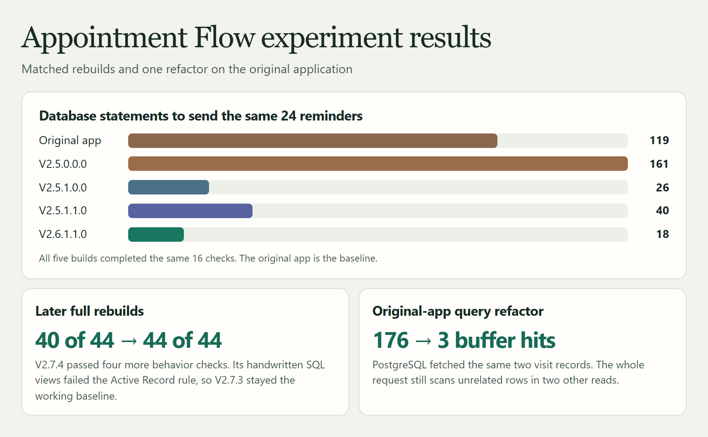

# Appointment Flow harness experiment

I tested how different coding instructions changed the Rails and React apps AI agents produced. I evaluated readability, ease of change, correct behavior, and database work.

[Version number key](#how-to-read-the-version-numbers) · [Every version](#version-by-version) · [Original-app refactors](#the-original-appointment-flow-and-its-refactors) · [Dashboard](dashboard/index.html) · [AI usage](AI_USAGE.md)

[What we grade and where](#what-we-grade-and-where) · [Reminder job and PMS reads](#reminder-job-and-pms-reads) · [Correctness and Active Record](#the-working-baseline-and-the-query-rule) · [How the versions were judged](#how-i-decided-which-version-was-better)

**28 run bundles** pair the recovered instructions with the application output. The index marks verified inputs, historical matches, and interrupted builds. [Browse the paired runs](runs/README.md)

## What we grade and where

These paths are for the original `appointment-flow` app. Start on `/` and choose a demo workspace and clinic. `:id` and `:token` come from the selected patient or message. Rebuilds can expose different routes for the same job. The benchmark adapters record the actual route or method for each build.

| Workflow | Page and request in the original app | What the checks verify |
|---|---|---|
| **Task lookup for a clinic** | `/front-desk?clinic=1` · `GET /api/board?clinic=1` | After opening the Front Desk queue, staff see their clinic's follow-up cases and the right patient links. Opening a card leads to that patient's workspace. [Workspace regression evidence](reports/PATIENT_APPOINTMENTS_REFACTOR.md) |
| **List a clinic's appointments** | `/appointments?clinic=1&date=today` · `GET /api/appointments?clinic=1&date=today` | Compare appointment IDs, counts, and dates. The staff appointment refactors also check responses and database work when older or unrelated visits are added. [Staff appointment cases](reports/V2.7.2_Refactor_Isolation_Comparison.md) |
| **Open a patient's details** | `/patient-details/:id` · `GET /api/patient-details/:id` | Check access for the selected clinic and the exact next appointment. On the scoped refactor, measure the access lookup and the complete request as data grows. [Patient details evidence](reports/PATIENT_APPOINTMENTS_MIRROR_INDEX.md) |
| **Read a patient's appointment history** | Open **Appointments** on `/patient-details/:id` · `GET /api/patient-details/:id/history?section=appointments&filter=past` | Match appointment IDs, page order, cursor, and recorded confirmations. The plan check measures work PostgreSQL does even when the response is identical. [History evidence](reports/PATIENT_APPOINTMENTS_MIRROR_INDEX.md) |
| **Send a clinic's reminders and create follow-up work** | Background worker calls `ReminderRunner.tick`. Resulting tickets appear on `/front-desk?clinic=1`. | Count expected fake sends and saved tickets, verify that neither is duplicated on retry, and measure the PMS read separately. [Reminder job evidence](#reminder-job-and-pms-reads) |
| **Handle a patient's reminder reply** | `/patient` · `POST /api/patient/messages/:token` | A unique, valid reply confirms the intended appointment. A number that becomes shared must lead to staff review. If the number is already shared at send time with no alternate channel, create a contact hold and send nothing. [Recipient scenarios](reports/V2.7.4_Candidate.md) |

The rubric also grades the code behind these workflows. The reviewer traces each selected entry point to the rule, checks what changes or rolls back on failure, and tests a small rule change in a disposable copy. The Active Record check follows queries through models and their database sources. These checks apply to the frozen code and have no app URL.

## How to read the version numbers

`V<family>.<base revision>.<performance>.<AI loop>.<existing-code revision>`

Each position tracks a different part of the harness. Versions can share the same foundation and vary only one part of it.

| Position | What it tracks | Example |
|---|---|---|
| **1 · Family** | The starting line of the harness. | `V2` and `V3` were separate early approaches. Later experiments continued from the `V2` family. |
| **2 · Base revision** | Changes to the core build guidance, including how code is organized, where rules live, and how failures are handled. | `V2.5.1.1.0` to `V2.6.1.1.0` advances the base from `5` to `6`. |
| **3 · Performance** | Changes to the instructions for spotting and measuring unnecessary work as data grows or a request repeats. | `V2.7.1.1.0` to `V2.7.2.1.0` advances the performance revision from `1` to `2`. |
| **4 · AI loop** | Changes to the automated grade, repair, and regrade instructions. | `V2.5.1.0.0` and `V2.5.1.1.0` share the same base and performance revisions. The second adds the AI loop. |
| **5 · Existing-code revision** | Changes to the guidance for working in an existing app. The published experiments in this position tested refactoring. | `V2.7.1.1.1` adds the staff-controller refactor guidance to `V2.7.1.1.0`. |

A `0` means that part has no separate revision in the label. The base can still contain guidance on that topic. The original `appointment-flow` is the app baseline, called V1 in early notes. Older short labels such as `V2.1.1`, `V2.6.1.2`, and `V3.1.1` retain their historical names. A suffix such as `original-isolated` identifies a specific trial and its starting conditions.

The two later branches explain why a number sometimes goes down. `V2.8.4.1.0` took the `V2.7.4.1.0` package and added a base rule about which event sets the clock. `V2.7.5.1.0` advanced performance guidance on a separate branch and added the executable Active Record check. `V2.8.4.1.0` carried performance revision `4` and omitted that checker. The `V2.8.5.1.1` candidate combines the base rule, the checker, and updated performance and refactor guidance.

## Version by version

**Paired ZIPs** include the recovered harness input and app output. **Harness ZIPs** contain guidance for designs with no completed app in the record. Full-build benchmarks, focused refactors, and historical source reviews each cover different evidence.

### The original appointment-flow and its refactors

| Version or trial | What changed and what we found | Files |
|---|---|---|
| **Original appointment-flow (V1)** | Established the product behavior and database baseline. It sent 24 synthetic reminders in 119 statements on the shared benchmark. | [Paired ZIP](runs/Original.zip) · [Benchmark](#the-reminder-benchmark) |
| **V2.7.2 original refactor** | Refactored the staff appointment action and its query from the original app. With the old coding guides still present, the result matched all 22 original responses. The old guides also reached the builder's context. | [Paired ZIP](runs/V2.7.2-original-refactor.zip) · [Results](reports/V2.7.2_Original_Refactor_Result.md) |
| **V2.7.2 original refactor, isolated** | Reran the same two-file refactor from the same original commit after removing old project guidance. It did less database work in the growth cases and matched 21 of 22 responses. The remaining difference was which confirmation the request saw during a concurrent write. | [Paired ZIP](runs/V2.7.2-original-isolated.zip) · [Side-by-side results](reports/V2.7.2_Refactor_Isolation_Comparison.md) |
| **V2.7.5.1.0 patient appointment refactor** | Added an explicit handwritten-SQL gate to the harness and moved query checks into each implementation step. The trial translated the original app's patient appointment query into plain Active Record. Ten paired HTTP responses matched. | [Paired ZIP](runs/V2.7.5.1.0-query-refactor.zip) · [Results](reports/PATIENT_APPOINTMENTS_REFACTOR.md) |
| **V2.7.5.1.0 app-owned index follow-up** | Tested two indexes on the app's database with the external PMS schema held fixed. Fetching the same two visits went from 176 buffer hits to three. The full request still earned REVISE because two reads did extra work as unrelated history grew. | [Paired ZIP](runs/V2.7.5.1.0-mirror-followup.zip) · [Results](reports/PATIENT_APPOINTMENTS_MIRROR_INDEX.md) |

### Early experiments

| Version | What changed and what we found | Files |
|---|---|---|
| **V2** | Became the code-quality starting point after the early source review. The experiment focused on simpler Active Record queries and failures that tell the caller what went wrong. | [Paired ZIP](runs/V2.zip) · [Source review](reports/Appointment_Flow_All_Versions_Review.md) |
| **V2.1** | Told the builder to filter and aggregate earlier, show workflow stages, and preserve distinct failures. The run raised a concern that broad simplification could crowd too much work into one controller. | [Paired ZIP](runs/V2.1.zip) · [Progress](reports/Appointment_Flow_Harness_Progress.md) |
| **V2.1.1** | Packaged the first AI grade, repair, and regrade loop. The experiment tested V2.1 and skipped this package. | [Harness ZIP](packages/Apex_Appointment_Flow_Harness_V2.1.1.zip) |
| **V2.2** | Revised the simplification guidance. The resulting services still lost private steps that would have made important decisions easier to find. | [Paired ZIP](runs/V2.2.zip) · [Regression log](reports/Appointment_Flow_Harness_Regression_Log.md) |
| **V2.3.0.0.0** | Made public entry points, named private stages, and failure paths explicit. The refresh still compressed several decisions into one large import method. | [Paired ZIP](runs/V2.3.0.0.0.zip) · [Source review](reports/Appointment_Flow_All_Versions_Review.md) |
| **V2.4.0.0.0** | Updated the review language and kept reference implementations outside the builder's inputs. The experiment still saw little change from guidance applied late in review. | [Paired ZIP](runs/V2.4.0.0.0.zip) · [Progress](reports/Appointment_Flow_Harness_Progress.md) |
| **V2.4.1.1.0** | Added performance checks and AI grading to the V2.4 base. A saved build was reviewed, with scoped measurements for the visit list and a six-send batch. A later matched trial was interrupted. | [Paired ZIP](runs/V2.4.1.1.0.zip) · [Interrupted trial ZIP](runs/V2.4.1.1.0-paired-interrupted.zip) · [Source review](reports/Appointment_Flow_All_Versions_Review.md) |
| **V3** | Tried a parallel set of broader Rails and React guides. Its controller actions often used custom names where familiar Rails resource actions would have made the routes easier to recognize. | [Paired ZIP](runs/V3.zip) · [Source review](reports/Appointment_Flow_All_Versions_Review.md) |
| **V3.1.1** | Added structured AI review to the V3 family. This is the earlier experiment originally labeled V4. | [Paired ZIP](runs/V3.1.1.zip) · [Source review](reports/Appointment_Flow_All_Versions_Review.md) |

The older archive also contains an app snapshot labeled `V26`. Its exact harness input is unverified. The separately reviewed refresh service proposal called `SourceRefreshProposalV3` has no verified versioned app release. [Historical source archive](snapshots/Appointment-Flow-All-Versions-Source.zip) · [Progress notes](reports/Appointment_Flow_Harness_Progress.md)

### Standalone full rebuilds

| Version | What changed and what we found | Files |
|---|---|---|
| **V2.5.0.0.0** | Returned to the V2 base and controlled the standalone launch settings. Reviewers preferred the folder structure, including the PMS model namespace. The 24-reminder batch used 161 statements. | [Paired ZIP](runs/V2.5.0.0.0.zip) · [Blind review](reports/V2.5_Baseline_Blind_Review.md) |
| **V2.5.1.0.0** | Added growth checks and audited query paths against the Rails guide. The 24-reminder run used 26 statements. On a separate two-reminder run, added unrelated appointments still raised rows returned to Rails from 13 to 1,213. | [Paired ZIP](runs/V2.5.1.0.0.zip) · [Active Record audit](reports/V2.5.1.0.0_Active_Record_Audit.md) |
| **V2.5.1.1.0** | Added AI grading, repair, and regrading. It fixed safety and setup gaps and kept the two-reminder growth case flat. Its 24-reminder run used 40 statements. The later matched attempt was interrupted. | [Paired ZIP](runs/V2.5.1.1.0.zip) · [Interrupted trial ZIP](runs/V2.5.1.1.0-paired-interrupted.zip) · [Comparison](reports/V2.5_Variant_Comparison.md) |
| **V2.6.1.1.0** | Moved growth checks into implementation and tested a small rule change in a disposable copy. A measured follow-up grouped equivalent writes and brought the 24-reminder run to 18 statements. | [Paired ZIP](runs/V2.6.1.1.0.zip) · [Run report](reports/V2.6_Run_Report.md) |
| **V2.7.1.1.0** | Clarified controller ownership, use of private methods, and plain Active Record. Its reply returned 609 rows after adding 600 later appointments. V2.6 returned 9 on that same case. | [Paired ZIP](runs/V2.7.1.1.0.zip) · [Comparison](reports/V2.7_Clean_Room_Comparison.md) |
| **V2.7.2.1.0** | Added checks for filtering too late, per-item work, large responses, and duplicate effects on retry. The repaired build passed the first 25 independent cases. An ordinary reply still transferred 600 extra rows in the grown fixture. | [Paired ZIP](runs/V2.7.2.1.0.zip) · [Results](reports/V2.7.3_Performance_Experiment.md#v27210-after-grading) |
| **V2.7.3.1.0** | Required the builder to explain which data supports an important lookup and who keeps it current. Review found the workflows easier to read and change. It became the working full-rebuild baseline with 40 of 44 behavior checks passing and first-time refresh work still high. | [Paired ZIP](runs/V2.7.3.1.0.zip) · [Results](reports/V2.7.3_Performance_Experiment.md) |
| **V2.7.4.1.0** | Checked recipient decisions against relevant history and tested the real prerequisite under growth. It passed 44 of 44 checks and cut the grown reminder case to 16 statements. Handwritten SQL in views and functions failed the plain Active Record standard. | [Paired ZIP](runs/V2.7.4.1.0.zip) · [Adoption decision](reports/V2.7.4_Candidate.md) |
| **V2.8.4.1.0** | Added a check that identifies the event that sets the clock for a time-dependent decision. It was packaged with no verified completed build. | [Harness ZIP](packages/Apex_Appointment_Flow_Harness_V2.8.4.1.0.zip) · [Evaluation plan](reports/Harness_Autonomous_Experiment_Plan.md) |
| **V2.8.5.1.1** | Restored the executable Active Record check, added executed-plan evidence for selective reads, and defined how to refactor an existing workflow while keeping its behavior. | [Harness ZIP](packages/Apex_Appointment_Flow_Harness_V2.8.5.1.1.zip) |

### Focused refactors on variant builds

| Version or trial | What changed and what we found | Files |
|---|---|---|
| **V2.7.1.1.1 staff appointments** | Applied the V2.7 rules to the frozen V2.6 controller. The public action became easier to follow. Weekly reads increased and a PostgreSQL expression remained in the reply-review lookup. | [Paired ZIP](runs/V2.7.1.1.1-staff-refactor.zip) · [Results](reports/V2.7_Staff_Appointments_Refactor.md) |
| **V2.6.1.2 staff appointments** | Separated naming and structure from query changes. The structure-only checkpoint kept the same responses and statement counts. The final result earned REVISE because the review lookup retained a PostgreSQL expression. | [Paired ZIP](runs/V2.6.1.2-staff-refactor.zip) · [Results](reports/V2.6.1.2_Staff_Appointments_Result.md) |
| **V2.7.3 refresh** | Reused tracked visits the refresh already read and selected fewer source fields. A grown confirming reply returned 2,417 rows to Rails, down from 3,019. The first-time refresh still needed 1,228 statements. | [Paired ZIP](runs/V2.7.3-refresh.zip) · [Results](reports/V2.7.3_Performance_Experiment.md#focused-refresh-refactor) |
| **V2.7.3 first-time writes** | Batched initial inserts with standard Active Record. Five write statements persisted the same 1,207 rows previously written one at a time. Rollback, retry, and calendar behavior passed the focused checks. | [Paired ZIP](runs/V2.7.3-cold-write.zip) · [Results](reports/V2.7.3_Performance_Experiment.md#first-time-persistence-result) |
| **V2.7.4 recipient rules** | Fixed cases where a historical patient shared a recipient's phone number outside the current appointment view. The scoped build passed all 44 checks using plain Active Record. Its source lookup still read more rows as history grew. | [Paired ZIP](runs/V2.7.4-recipient.zip) · [Results](reports/V2.7.4_Candidate.md#matched-recipient-control) |

The [harness archive catalog](VERSIONS.md) includes the standalone guidance packages, refactor overlays, and the distinct V2.5.1.1.0 variant input. The [regression log](reports/Appointment_Flow_Harness_Regression_Log.md) records changes that made results worse and what later trials changed in response.

## What improved

### Reminder job and PMS reads

The original app runs `ReminderJob` in Sidekiq. It calls `ReminderRunner.tick` in the background. The test runs the same `tick` with synthetic data, without job-queue waiting time.

1. **Read the PMS.** The job refreshes the app's local copy from the read-only replica before sending. PostgreSQL returns one JSON result for clinics, one for patients, and one for appointments. The appointment read has a date window and includes tracked appointments that have moved. The patient read fetches the whole source patient table.
2. **Update the app and decide what is due.** The job saves changed facts to the app database, reconciles visits, and checks which clinics and patients are eligible. A failed refresh pauses outreach.
3. **Save follow-up work and fake sends.** Issues appear in the clinic queue at `/front-desk?clinic=1` through `GET /api/board?clinic=1`. A same-clock retry should save zero additional tickets and sends.

The mixed workload starts with 24 appointments. Eight are due for the initial reminder, eight are on the following day with no response on record, and eight lack a usable contact. The first tick creates 16 tickets and records 16 fake emails. The retry must preserve the exact stored outcome. This exercises a different workload from the 24-send comparison below.

| Original app fixture and run | New tickets | New sends | Database statements | PMS response bytes | App rows affected by refresh |
|---|---:|---:|---:|---:|---:|
| 24 source patients, first tick | 16 | 16 | 239 | 8,893 | 73 |
| 2,024 source patients, first tick | 16 | 16 | 239 | 393,743 | 2,073 |
| 24 source patients, same-clock retry | 0 | 0 | 88 | 8,893 | 1 |
| 2,024 source patients, same-clock retry | 0 | 0 | 88 | 393,743 | 1 |

The extra 2,000 patients had no appointments and unique contacts. They left the job's visible result unchanged. The PMS patient response grew from 4,331 to 389,181 bytes, and the initial refresh wrote 2,000 extra patient rows. Each retry fetched the same source payload again and only updated the app's sync row. The original still used three PMS data reads in each tick.

[Reminder job dashboard](dashboard/index.html#original-job) · [Benchmark and query counts](benchmarks/Original_Reminder_Job_PMS_Workload.csv) · [Original worker and service source](https://github.com/joshrice171723-creator/appointment-flow/tree/db037d7932b13fc4d735106e0fa199815fb2d22c/backend/app)

### The reminder benchmark

Each build sent the same 24 synthetic reminders and passed the same 16 checks. The original app is the historical baseline.

| Version | Execution environment | Database statements for 24 reminders |
|---|---|---:|
| Original appointment-flow | Historical app | 119 |
| V2.5.0.0.0 | Standalone Codex | 161 |
| V2.5.1.0.0 | Standalone Codex | 26 |
| V2.5.1.1.0 | Standalone Codex | 40 |
| V2.6.1.1.0 | Standalone Codex | 18 |
| V2.7.1.1.0 | Standalone Codex | 45 |

- **85% fewer statements in V2.6.1.1.0.** Grouping equivalent writes brought the batch down from the original’s 119 statements to 18.
- **62% fewer statements in V2.7.1.1.0.** It used 45 statements for the same 24 sends. V2.6 used fewer writes and returned fewer rows for the matched reply under growth. [Six-build workload](benchmarks/V2.7_Compared_Workload.csv) · [Tradeoffs](reports/V2.7_Clean_Room_Comparison.md)
- **Query count can hide growth.** V2.5.1.0.0 still sent the same two reminders in 26 statements after adding 600 later appointments. Rows returned to Rails rose from 13 to 1,213. [Run report](reports/V2.6_Run_Report.md) · [Matched workload](benchmarks/V2.6_Compared_Workload.csv)

### The working baseline and the query rule

| Build | Behavior checks | Statements for two reminders with 600 later appointments | Decision |
|---|---:|---:|---|
| Original appointment-flow | Unmeasured on this suite | — | Historical baseline |
| V2.7.3.1.0 | 40 of 44 | 1,228 | Working full-rebuild baseline |
| V2.7.4.1.0 | 44 of 44 | 16 | Authored SQL in views and functions failed the Active Record rule |

[Matched comparison and decision](reports/V2.7.4_Candidate.md)

### The refactor on the original app

- **V2.7.5.1.0 checked where the query logic lives.** The refactor replaced handwritten SQL in the patient appointment query with standard Active Record.
- **Both app-owned indexes earned their place.** Fetching the same two visits went from 176 PostgreSQL buffer hits to three on the grown fixture. The external PMS schema stayed fixed.
- **All 330 measured requests preserved responses and cursors.** The full request still earned REVISE because patient authorization and one upcoming-history join scanned unrelated rows. [Query refactor](reports/PATIENT_APPOINTMENTS_REFACTOR.md) · [Index follow-up](reports/PATIENT_APPOINTMENTS_MIRROR_INDEX.md) · [Request metrics](benchmarks/V2.7.5_Patient_Appointment_Index_Workload.csv)

## How I decided which version was better

1. Compare the same caller, input, response, and persisted effects on frozen revisions. Use controlled rebuilds and scoped refactors to answer different questions.
2. Measure statements, rows returned, records loaded, writes, and elapsed time separately. Add unrelated history, grow eligible work, and replay the same request where appropriate.
3. Trace the entry point to the business rule and failure boundary. Test a small rule change in a disposable copy to see where a developer would make it.
4. Verify standard Active Record at the application query source. Rails-generated SQL is expected. Trace through schema objects so a model mapped to a handwritten query view cannot pass by appearance.
5. Record what the AI review fixed, where it missed a regression, and what the independent checks established. A scoped pass only establishes the behavior exercised in that scope.

One build per variant gives evidence about those builds. Host settings and the builder’s design choices also affect the result. The [version history](VERSIONS.md) marks historical observations, measured runs, prepared runs, and packaged proposals.

## Explore and reproduce

- Open `dashboard/index.html` in a browser from a local clone. The shared comparison starts with the original app. Later trials appear under Harness versions.
- Use the [version catalog](VERSIONS.md) for harness archives and [frozen application builds](snapshots/FROZEN_BUILDS.md) for the recorded revisions. Compare public archives against [SHA-256 checksums](SHA256SUMS.txt).
- Use the [launch prompt](reports/V2.5_Launch_Prompt.md), [benchmark CSVs](benchmarks/), and linked run reports to identify the workload and frozen checkpoints.
- The company-supplied take-home PDF is omitted from public files and nested archives. The public exports include the author’s code and screenshots. Original preflight expects the original reference inputs. The archive manifest records separate digests for source inputs and published exports.
