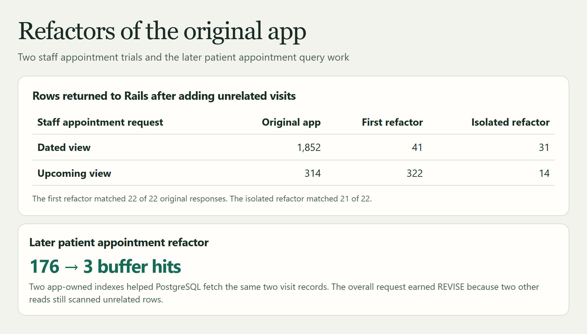

# Appointment Flow harness experiment

I tested how different coding instructions changed the Rails and React apps AI agents produced. I evaluated readability, ease of change, correct behavior, and database work.

[Final product](#final-product--curated-original-refactor) · [Version number key](#how-to-read-the-version-numbers) · [Every version](#version-by-version) · [Original-app refactors](#the-original-appointment-flow-and-its-refactors) · [Dashboard](dashboard/index.html) · [AI usage](AI_USAGE.md)

[What we grade and where](#what-we-grade-and-where) · [Reminder job and PMS reads](#reminder-job-and-pms-reads) · [Correctness and Active Record](#historical-full-build-results-and-the-query-rule) · [How the versions were judged](#how-i-decided-which-version-was-better)

[Search the evidence dashboard](dashboard/index.html#evidence) · [Browse all saved datasets and reports](reports/EVIDENCE_INDEX.md) · [Database performance and automation scores](reports/DATABASE_RUN_SCORES.md) · [Download structured evidence](dashboard/evidence.json)

## Final product · curated original refactor

The final app preserves the original workflows and fixed external PMS schema. It starts from the V2.10.6.3.1 original refactor and combines measured improvements from the experiment. I integrated and verified these changes in a separate checkout. The result is a directed integration of the experiment's strongest approaches.

[Run the app](final-app/README.md) · [Download the app ZIP](final-app/Appointment-Flow-Curated-Refactor.zip) · [Source revisions and checksums](final-app/provenance.json) · [Download all 420 case results](benchmarks/Appointment_Flow_V1.1.0_Results.csv)

**The final app passed 60 of 60 cases.** The curated app had the highest V1.1.0 score among the refactors. Both it and the original round to 64/100. The original led the full cohort with 64.09 points. The final app scored 63.58 points.

### The same benchmark across seven applications

V1.1.0 gives each workflow 20 points. It scores only cases with verified behavior. The score compares statement counts, rows returned, and Rails objects loaded. The two reminder groups also count rows written and PMS rows returned. A low query count alone cannot earn a high score. Each case uses the best passing counter in this cohort as its reference. The scorer divides the best passing count plus one by the measured count plus one for each metric. Read requests weight statements at 40%, returned rows at 30%, and loaded models at 30%. Reminder runs weight statements, writes, and PMS rows at 25% each. Rails rows contribute 15% and loaded models contribute 10%. Each workflow score averages its case scores.

| Application | Revision | Overall | Cases passed | First run /20 | Retry /20 | Staff /20 | Patient /20 | Guardian /20 |
| --- | --- | --- | --- | --- | --- | --- | --- | --- |
| Original app | db037d7 | 64/100 | 60/60 | 4.90 | 7.69 | 12.78 | 18.80 | 19.92 |
| Curated original refactor | 50b69ee | 64/100 | 60/60 | 4.86 | 7.99 | 13.44 | 17.73 | 19.56 |
| V2.10.6.3.1 original refactor | e27aca2 | 61/100 | 60/60 | 4.78 | 7.58 | 13.44 | 17.93 | 17.63 |
| V2.8.5.1.1 original refactor | 235c16d | 55/100 | 60/60 | 4.90 | 7.69 | 12.78 | 18.14 | 11.96 |
| V2.7.4.1.0 full build | 860fa23 | 46/100 | 14/60 | 18.73 | 18.78 | 8.70 | 0.00 | 0.00 |
| V2.10.6.3.1 full build | 9a5dbce | 33/100 | 16/60 | 9.53 | 15.31 | 8.42 | 0.00 | 0.00 |
| V2.7.4 Active Record full build refactor | 6c9e20a | 12/100 | 6/60 | 0.00 | 0.00 | 11.60 | 0.00 | 0.00 |

The benchmark starts from raw PMS fields. It counts the first import, application mirror work, staff tickets, and simulated sends. It repeats the same operation to check for duplicate effects. It then checks clinic appointments, patient details and history, and guardian access. A full build can score zero for an original workflow it does not support. The earlier 91, 94, and 96 scores used different scopes. The original led the patient group. On the past appointments page with added history, it returned 61 rows to Rails. The final app returned 87 because it reads two candidate lists before it merges the page. The final app still used fewer PostgreSQL buffer accesses for that request, from 522 to 165. The V1.1.0 score counts the returned rows. It records query-plan work separately.

### What changed in the final app

| Operation | Measure | Original | Refactor base | Final app |
| --- | --- | --- | --- | --- |
| First reminder run · 96 relevant appointments | Database statements | 815 | 848 | 658 |
| First reminder run · 96 relevant appointments | Rows affected | 802 | 962 | 962 |
| Retry · 2,000 extra source patients | App rows returned | 264 | 2,312 | 248 |
| Retry · 2,000 extra source patients | PMS rows returned | 2,049 | 2,049 | 2,049 |
| Clinic calendar · 20 extra eligible appointments | Database statements | 12 | 11 | 11 |
| Authorized guardian opens ward history · grown data | Database statements | 4 | 9 | 7 |
| Patient opens upcoming appointments · grown data | PostgreSQL buffer accesses in captured SELECTs | 521 | — | 163 |

1. **Send reminders and open staff tickets.** Keep the original transaction and recipient checks. Reuse case and issue reads within the locked clinic batch. Keep collection writes on the batch path. The background worker calls `ReminderRunner.tick`. Staff see the tickets on `/front-desk?clinic=1`. [Reminder code](final-app/backend/app/services/reminder_sender.rb)
2. **Refresh the app mirror.** Compare the snapshot digest before reading the mirror for unchanged source rows. The source connection still reads 2,049 rows in the extra-patient case. The first large run also writes more rows than the original because the refactor retains contact comparison data and a history projection. [Snapshot code](final-app/backend/app/services/pms_snapshot.rb)
3. **Open patient history.** Reuse the earlier refactor's visit index and fetch the latest patient reply for each visit. The original and final app returned the same ten bodies and cursors. Across the five grown requests, the captured SELECTs used 2,536 versus 778 buffer accesses. These counters show work inside PostgreSQL. [Patient history code](final-app/backend/app/queries/patient_appointments_query.rb)
4. **Check guardian access.** Look up direct access and valid guardian permission in one Active Record relation. The tests cover replaced and revoked permissions, another clinic, and authorized history access. [Access code](final-app/backend/app/controllers/desk_controller.rb)

The final backend suite passed 131 tests with 1,984 assertions. The application query check passed on the migrated database. The frontend build and Compose configuration check passed. Existing PostgreSQL commands handle locks, connection policy, schema setup, and statistics. The query changes use plain Active Record.

The application benchmark has two recorded versions. V1.0.0 measures individual workflows. V1.1.0 scores the expanded workload. The evaluator keeps its protocol, scripts, and fixtures outside the repository and the clean-room build context. The curated integration also used earlier measurements to select changes. Its final score comes from a new run on frozen source.

| Experiment type | Starting point |
|---|---|
| **full build** | A fresh app built from the assignment with the selected harness. |
| **full build refactor** | An existing app produced by a full build. Record any directed follow-up separately from the harness's own loop. |
| **original refactor** | The original `appointment-flow` app or a recorded checkpoint in its refactor lineage. |

The V2.7.4.1.0 **full build** at `860fa23` scored **91/100** and received Joshua's readability PASS. Its later **full build refactor (directed)** at `6c9e20a` scored **94/100**. That refactor's measured caller costs exclude the fixture work that populates stored contact keys. Its exact code has no later complete readability and changeability regrade. [Readability and provenance](reports/V2.7.4.1.0_Readability_Assessment.md)

## How the experiment progressed

1. **Review the first outputs.** I compared four versions of the app. The original already had useful product behavior. V2 gave me a clearer coding baseline for query and workflow decisions.
2. **Test the instructions in full builds.** Later builds recorded the starting package, model, launch prompt, and final code. The earliest recovered runs have less launch evidence. The version table marks those differences.
3. **Test individual workflows.** I used scoped refactors to trace clinic selection, appointment history, reminder delivery, and follow-up tickets. These trials helped isolate query changes from larger app differences.
4. **Check behavior before comparing cost.** I checked exact response fields, recipients, saved effects, repeat behavior, and permission changes. I measured statement counts, returned rows, writes, and database plan work where available.
5. **Keep independent evaluation separate.** The final benchmark runs after the application freezes. The repository includes results and evidence summaries. The private test code and inputs stay with the evaluator.
6. **Combine the measured improvements on the original app.** The final integration draws from the strongest original refactor, the earlier patient history repair, and the full build's batch processing. Each change has its own verification record.

### How to read a score

Every score names its benchmark, application revision, and workload. Earlier scores cover smaller scopes. The V1.1.0 benchmark covers five workflows and 60 cases. Each workflow contributes up to 20 points. Compare scores within the same set of applications, and use the raw counters to explain the result.

**35 run bundles** pair the recovered instructions with the application output. The index marks verified inputs, historical matches, and interrupted builds. [Browse the paired runs](runs/README.md)

## Read the comparisons

| What you want to know | What to hold constant | Where to check |
|---|---|---|
| **Did the reminder job send the correct reminders?** | Use the same case, clock, clinic, and contact data. Compare the recipients, saved sends, and staff tickets. Then compare first run and retry separately. | [Reminder test cases](#reminder-job-and-pms-reads) |
| **Did it read too much data from the PMS?** | In the original job, the small and grown first-run fixtures both produced 16 tickets and used 239 database statements. The PMS returned 8,893 bytes on the small fixture and 393,743 bytes on the grown fixture. | [Original job measurements](benchmarks/Original_Reminder_Job_PMS_Workload.csv) |
| **Did the patient history request do less database work?** | Compare the same response and cursor on the same fixture. With added unrelated appointments, the measured upcoming-history SELECTs used 521 PostgreSQL buffer accesses in the original app and 28 after the focused repair. | [Patient request measurements](benchmarks/V2.8.5_Patient_Appointments_Workload.csv) |
| **Did the harness grade agree with independent checks?** | Check the exact revision and scope. V2.8.5.1.1 passed its own rebuild rubric and passed 42 of 44 independent checks. The two independent failures concerned weekly counts. | [Rebuild validation](reports/V2.8.5_Harness_Validation.md) |

### Database performance and automation scores

| Same workload | Original or control | Best recorded comparison | What it tells you |
|---|---:|---:|---|
| Standard application workload, 16 cases | Original 48/100 | V2.7.4.1.0 full build refactor (directed) 94/100 | The V2.7.4.1.0 full build scored 91/100. The directed refactor excludes stored-key fixture preparation and has no complete readability regrade. |
| Patient details and appointment history, 10 cases | Original 57/100 | V2.8.5.1.1 original refactor after its benchmark repair loop 96/100 | The same refactor's initial benchmark checkpoint scored 87/100. Exact page bodies and cursors matched. |
| V2.9.5.1.1 growth check, four fixed-output cases | Small fixture 100/100 | Grown fixture 91/100 | The source ownership lookup drove the extra work in the first eligible reminder batch. |

The performance score uses the lowest measured work within each table. The separate automation score counts six kinds of recorded checks. The rank tables include the metric weights, exact datasets, and runs without enough evidence for a score. [Full score tables](reports/DATABASE_RUN_SCORES.md)

V2.9.5.1.1 now has the same 44-case benchmark as the later V2.7 and V2.8.5 full builds. It passed all outcomes and the Active Record source check. Sending two reminders with 2,000 extra patients still read 2,007 rows. The V2.7.4.1.0 directed full build refactor read nine. The scores were recalculated with the new run included, so that refactor's standard score changed from 95 to 94. [Matched results and raw trace](reports/V2.9.5.1.1_Full_Benchmark.md)

## What we grade and where

These paths are for the original `appointment-flow` app. Start on `/` and choose a demo workspace and clinic. `:id` and `:token` come from the selected patient or message. Rebuilds can expose different routes for the same job. The benchmark adapters record the actual route or method for each build.

| Workflow | Page and request in the original app | What the checks verify |
|---|---|---|
| **Task lookup for a clinic** | `/front-desk?clinic=1` · `GET /api/board?clinic=1` | After opening the Front Desk queue, staff see their clinic's follow-up cases and the right patient links. Opening a card leads to that patient's workspace. [Workspace regression evidence](reports/PATIENT_APPOINTMENTS_REFACTOR.md) |
| **List a clinic's appointments** | `/appointments?clinic=1&date=today` · `GET /api/appointments?clinic=1&date=today` | Compare appointment IDs, counts, and dates. The staff appointment refactors also check responses and database work when older or unrelated visits are added. [Staff appointment cases](reports/V2.7.2_Refactor_Isolation_Comparison.md) |
| **Open a patient's details** | `/patient-details/:id` · `GET /api/patient-details/:id` | Check access for the selected clinic and the exact next appointment. On the scoped refactor, measure the access lookup and the complete request as data grows. [Patient details evidence](reports/PATIENT_APPOINTMENTS_MIRROR_INDEX.md) |
| **Read a patient's appointment history** | Open **Appointments** on `/patient-details/:id` · `GET /api/patient-details/:id/history?section=appointments&filter=past` | Match appointment IDs, page order, cursor, and recorded confirmations. The plan check measures work PostgreSQL does even when the response is identical. [History evidence](reports/PATIENT_APPOINTMENTS_MIRROR_INDEX.md) |
| **Send a clinic's reminders and create follow-up work** | Background worker calls `ReminderRunner.tick`. Resulting tickets appear on `/front-desk?clinic=1`. | Count expected fake sends and saved tickets, verify that neither is duplicated on retry, and measure the PMS read separately. [Reminder job evidence](#reminder-job-and-pms-reads) |
| **Handle a patient's reminder reply** | `/patient` · `POST /api/patient/messages/:token` | A unique, valid reply confirms the intended appointment. A number that becomes shared must lead to staff review. If the number is already shared at send time with no alternate channel, create a contact hold and send nothing. [Recipient scenarios](reports/V2.7.4_Candidate.md) |

The rubric also grades the code for these workflows. The reviewer follows each entry point to the business rule. The reviewer records what the app saves or rolls back after a failure. The reviewer tests a small rule change in a separate copy. The Active Record check follows each query to its data source. These checks use frozen code.

## How to read the version numbers

`V<family>.<base revision>.<performance>.<AI loop>.<existing-code revision>`

Each position tracks a different part of the harness. Versions can share the same foundation and vary only one part of it.

| Position | What it tracks | Example |
|---|---|---|
| **1 · Family** | The starting line of the harness. | `V2` and `V3` were separate early approaches. Later experiments continued from the `V2` family. |
| **2 · Base revision** | Changes to the core build guidance, including how code is organized, where rules live, and how failures are handled. | `V2.5.1.1.0` to `V2.6.1.1.0` advances the base from `5` to `6`. |
| **3 · Performance** | Changes to the instructions for spotting and measuring unnecessary work as data grows or a request repeats. | `V2.7.1.1.0` to `V2.7.2.1.0` advances the performance revision from `1` to `2`. |
| **4 · AI loop** | Changes to the automated grade, repair, and regrade instructions. | `V2.5.1.0.0` and `V2.5.1.1.0` share the same base and performance revisions. The second adds the AI loop. |
| **5 · Existing-code revision** | Changes to the guidance for working in an existing app. The published experiments in this position tested refactoring. | `V2.7.1.1.1` adds the staff-controller refactor guidance to `V2.7.1.1.0`. |

A `0` means that part has no separate revision in the label. The base can still contain guidance on that topic. The original `appointment-flow` is the app baseline, called V1 in early notes. Older short labels such as `V2.1.1`, `V2.6.1.2`, and `V3.1.1` retain their historical names. A suffix such as `original-isolated` identifies a specific trial and its starting conditions.

The two later branches explain why a number sometimes goes down. `V2.8.4.1.0` took the `V2.7.4.1.0` package and added a base rule about which event sets the clock. `V2.7.5.1.0` advanced performance guidance on a separate branch and added the executable Active Record check. `V2.8.4.1.0` carried performance revision `4` and omitted that checker. The `V2.8.5.1.1` candidate combines the base rule, the checker, and updated performance and refactor guidance.

## Version by version

**Paired ZIPs** include the recovered harness input and app output. **Harness ZIPs** contain guidance for designs with no completed app in the record. Full-build benchmarks, focused refactors, and historical source reviews each cover different evidence.

### Later harness versions

| Version and run | What was tested | Result |
| --- | --- | --- |
| **V2.10.6.1.1** | Packaged portable rules for existing projects. | Package evidence. No completed application benchmark in this record. [Harness ZIP](packages/Apex_Appointment_Flow_Harness_V2.10.6.1.1.zip) |
| **V2.10.6.2.1** | Directed refactor of the V2.7.4.1.0 full build. | The builder received benchmark information. Use the result to study the repair loop. [Paired ZIP](runs/V2.10.6.2.1-full-build-refactor.zip) |
| **V2.10.6.3.1 full build** | Clean-room rebuild at `9a5dbce`. | Passed 16 of 60 V1.1.0 cases. Its reminder batch was efficient. The original patient history and guarantor contracts were outside its implementation. [Paired ZIP](runs/V2.10.6.3.1-full-build.zip) |
| **V2.10.6.3.1 original refactor** | Refactor at `e27aca2`. | Passed all 60 cases and had the highest score among the original refactors before the final integration. [Paired ZIP](runs/V2.10.6.3.1-original-refactor.zip) |
| **V2.7.4 Active Record full build refactor** | Follow-up on the fresh V2.7.4 build at `6c9e20a`. | Passed the earlier scoped tests. Its final raw-source first load failed because required derived values had no normal source-write owner. |

See the [version catalog](VERSIONS.md) and [paired run index](runs/README.md) for each archived input and checkpoint.

### The original appointment-flow and its refactors

| Version or trial | What changed and what we found | Files |
|---|---|---|
| **Original appointment-flow (V1)** | Established the product behavior and database baseline. It sent 24 synthetic reminders in 119 statements on the shared benchmark. | [Paired ZIP](runs/Original.zip) · [Benchmark](#the-reminder-benchmark) |
| **V2.7.2 original refactor** | Refactored the staff appointment action and its query from the original app. With the old coding guides still present, the result matched all 22 original responses. The old guides also reached the builder's context. | [Paired ZIP](runs/V2.7.2-original-refactor.zip) · [Results](reports/V2.7.2_Original_Refactor_Result.md) |
| **V2.7.2 original refactor, isolated** | Reran the same two-file refactor from the same original commit after removing old project guidance. It did less database work in the growth cases and matched 21 of 22 responses. The remaining difference was which confirmation the request saw during a concurrent write. | [Paired ZIP](runs/V2.7.2-original-isolated.zip) · [Side-by-side results](reports/V2.7.2_Refactor_Isolation_Comparison.md) |
| **V2.7.5.1.0 original refactor, query checkpoint** | Added an explicit handwritten-SQL gate to the harness and moved query checks into each implementation step. The trial translated the original app's patient appointment query into plain Active Record. Ten paired HTTP responses matched. | [Paired ZIP](runs/V2.7.5.1.0-query-refactor.zip) · [Results](reports/PATIENT_APPOINTMENTS_REFACTOR.md) |
| **V2.7.5.1.0 original refactor, index checkpoint** | Tested two indexes on the app's database with the external PMS schema held fixed. Fetching the same two visits went from 176 buffer hits to three. The full request still earned REVISE because two reads did extra work as unrelated history grew. | [Paired ZIP](runs/V2.7.5.1.0-mirror-followup.zip) · [Results](reports/PATIENT_APPOINTMENTS_MIRROR_INDEX.md) |
| **V2.8.5.1.1 original refactor, historical loop** | The initial benchmark checkpoint scored 87/100 and still scanned upcoming history broadly. A benchmark repair round under the same harness used a Rails ownership association and scored 96/100. On the larger fixture, upcoming history used 28 buffers, down from 521 in the original. These are checkpoints of one loop-enabled original refactor. | [Initial checkpoint ZIP](runs/V2.8.5.1.1-refactor.zip) · [After-loop ZIP](runs/V2.8.5.1.1-refactor-repair.zip) · [Loop evidence](reports/AI_Loop_Evidence.md) · [Expanded historical benchmark](reports/Benchmark_V1.0.0_Historical_V2.8.5.1.1_Report.md) |

#### How the historical V2.8.5.1.1 original refactor loop ran

1. The original baseline was `db037d7`. The V2.7.5.1.0 snapshot had already converted the patient history query to Active Record and added two indexes to the app database.
2. The V2.8.5.1.1 refactor started from that snapshot in a separate session. The agent read `AI_USAGE.md` and `DECISIONS.md`. The prompt asked it to measure the patient detail and history requests, preserve the external PMS schema, keep access and paging behavior, and repair verified findings. [Refactor prompt and input](runs/V2.8.5.1.1-refactor.zip)
3. A separate replay found a remaining scan of 5,577 mirror appointments. The next benchmark repair round used the same V2.8.5.1.1 harness from `500c78e` and targeted the upcoming-history read. The after-loop checkpoint is `235c16d`. The original and repaired responses matched in the replay. [Repair prompt and result](runs/V2.8.5.1.1-refactor-repair.zip)

The historical result includes the benchmark-directed repair round. The fresh original refactor listed above starts again from current `main`. Its results will have their own source revisions and evidence. [Historical Benchmark V1.0.0 result](reports/Benchmark_V1.0.0_Historical_V2.8.5.1.1_Report.md)

#### Ruby lines in the original and historical after-loop checkpoint

The count includes every line in the tracked `.rb` files under these six directories, including blank lines and comments. Both revisions have 53 files in this scope. The size increase is concentrated in query code. [Line count data](benchmarks/V2.8.5_Original_Refactor_Ruby_Lines.csv)

| Directory under `backend/app` | Original `db037d7` | After-loop original refactor `235c16d` | Change |
|---|---:|---:|---:|
| Controllers | 228 | 224 | −4 |
| Jobs | 14 | 14 | 0 |
| Models | 387 | 394 | +7 |
| Queries | 731 | 831 | +100 |
| Serializers | 153 | 153 | 0 |
| Services | 1,374 | 1,379 | +5 |
| **Total** | **2,887** | **2,995** | **+108** |

The two largest changes were `patient_appointments_query.rb` at +51 lines and `contact_profiles_query.rb` at +41. The original-to-final comparison includes the earlier Active Record conversion and both V2.8.5.1.1 passes.

#### Original app and historical after-loop checkpoint on the same patient requests

| Review check | Original `db037d7` | After-loop original refactor `235c16d` |
|---|---|---|
| Matched request tests | 199 assertions passed | 199 assertions passed. Response bodies and cursors matched the original. |
| External PMS schema and access | Schema and read-only access established the baseline | Same schema checksum and read-only permissions |
| Scoped rubric grade | 5 PASS and 3 REVISE. The review found query growth, an implicit appointment ownership rule, and a source check failure. | 8 scoped PASS grades from the builder. An independent replay verified the behavior and performance results below. |
| Active Record rule | The patient appointment query used handwritten SQL | The changed files passed the scoped source check. The full repository still had 17 inherited findings. |
| Ease of change | One change from 25 to 10 at the page-size constant passed in a disposable copy. | The same change passed in a disposable copy. Paging and order held on the grown fixture. |

[All eight criteria and supporting checks](reports/ORIGINAL_PATIENT_READ_RUBRIC.md)

The grown fixture adds 5,000 mirror appointments and 15,000 tracked visits. Each arrow shows the original value followed by the refactor value. Both versions recorded zero writes for these requests. **Buffers** count database page accesses for the captured SELECTs. **Statements** count the whole request. Each timing is the median of five samples. [All small and grown measurements](benchmarks/V2.8.5_Patient_Appointments_Workload.csv) · [Rubric and replay evidence](reports/V2.8.5_Harness_Validation.md)

| Request on the grown fixture | PostgreSQL buffers | Statements | Rows returned | Rails records loaded | Median request time (ms) |
|---|---:|---:|---:|---:|---:|
| Past history, first page | 522 → 30 | 16 → 19 | 61 → 62 | 59 → 35 | 262.1 → 48.9 |
| Past history, next page | 510 → 31 | 7 → 12 | 56 → 57 | 55 → 30 | 177.0 → 32.7 |
| Upcoming history | 521 → 28 | 16 → 19 | 14 → 14 | 12 → 11 | 146.1 → 48.8 |
| Patient details | 288 → 23 | 18 → 20 | 12 → 13 | 7 → 7 | 142.2 → 70.7 |
| Tracked-only past history | 695 → 28 | 15 → 20 | 58 → 59 | 32 → 32 | 178.2 → 173.9 |

### Early experiments

| Version | What changed and what we found | Files |
|---|---|---|
| **V2** | Became the code-quality starting point after the early source review. The experiment focused on simpler Active Record queries and failures that tell the caller what went wrong. | [Paired ZIP](runs/V2.zip) · [Source review](reports/Appointment_Flow_All_Versions_Review.md) |
| **V2.1** | Told the builder to filter and aggregate earlier, show workflow stages, and preserve distinct failures. The run raised a concern that broad simplification could crowd too much work into one controller. | [Paired ZIP](runs/V2.1.zip) · [Progress](reports/Appointment_Flow_Harness_Progress.md) |
| **V2.1.1** | Packaged the first AI grade, repair, and regrade loop. The experiment tested V2.1 and skipped this package. | [Harness ZIP](packages/Apex_Appointment_Flow_Harness_V2.1.1.zip) |
| **V2.2** | Revised the simplification guidance. The resulting services still lost private steps that would have made important decisions easier to find. | [Paired ZIP](runs/V2.2.zip) · [Regression log](reports/Appointment_Flow_Harness_Regression_Log.md) |
| **V2.3.0.0.0** | Made public entry points, named private stages, and failure paths explicit. The refresh still compressed several decisions into one large import method. | [Paired ZIP](runs/V2.3.0.0.0.zip) · [Source review](reports/Appointment_Flow_All_Versions_Review.md) |
| **V2.4.0.0.0** | Updated the review language and kept reference implementations outside the builder's inputs. The experiment still saw little change from guidance applied late in review. | [Paired ZIP](runs/V2.4.0.0.0.zip) · [Progress](reports/Appointment_Flow_Harness_Progress.md) |
| **V2.4.1.1.0** | Added performance checks and AI grading to the V2.4 base. A saved build was reviewed, with scoped measurements for the visit list and a six-send batch. A later matched trial was interrupted. | [Paired ZIP](runs/V2.4.1.1.0.zip) · [Interrupted trial ZIP](runs/V2.4.1.1.0-paired-interrupted.zip) · [Source review](reports/Appointment_Flow_All_Versions_Review.md) |
| **V3** | Tried a parallel set of broader Rails and React guides. Its controller actions often used custom names where familiar Rails resource actions would have made the routes easier to recognize. | [Paired ZIP](runs/V3.zip) · [Source review](reports/Appointment_Flow_All_Versions_Review.md) |
| **V3.1.1** | Added structured AI review to the V3 family. This is the earlier experiment originally labeled V4. | [Paired ZIP](runs/V3.1.1.zip) · [Source review](reports/Appointment_Flow_All_Versions_Review.md) |

The older archive also contains an app snapshot labeled `V26`. Its exact harness input is unverified. The separately reviewed refresh service proposal called `SourceRefreshProposalV3` has no verified versioned app release. [Historical source archive](snapshots/Appointment-Flow-All-Versions-Source.zip) · [Progress notes](reports/Appointment_Flow_Harness_Progress.md)

### Full builds

| Version | What changed and what we found | Files |
|---|---|---|
| **V2.5.0.0.0** | Returned to the V2 base and controlled the standalone launch settings. Reviewers preferred the folder structure, including the PMS model namespace. The 24-reminder batch used 161 statements. | [Paired ZIP](runs/V2.5.0.0.0.zip) · [Blind review](reports/V2.5_Baseline_Blind_Review.md) |
| **V2.5.1.0.0** | Added growth checks and audited query paths against the Rails guide. The 24-reminder run used 26 statements. On a separate two-reminder run, added unrelated appointments still raised rows returned to Rails from 13 to 1,213. | [Paired ZIP](runs/V2.5.1.0.0.zip) · [Active Record audit](reports/V2.5.1.0.0_Active_Record_Audit.md) |
| **V2.5.1.1.0** | Added AI grading, repair, and regrading. It fixed safety and setup gaps and kept the two-reminder growth case flat. Its 24-reminder run used 40 statements. The later matched attempt was interrupted. | [Paired ZIP](runs/V2.5.1.1.0.zip) · [Interrupted trial ZIP](runs/V2.5.1.1.0-paired-interrupted.zip) · [Comparison](reports/V2.5_Variant_Comparison.md) |
| **V2.6.1.1.0** | Moved growth checks into implementation and tested a small rule change in a disposable copy. A measured follow-up grouped equivalent writes and brought the 24-reminder run to 18 statements. | [Paired ZIP](runs/V2.6.1.1.0.zip) · [Run report](reports/V2.6_Run_Report.md) |
| **V2.7.1.1.0** | Clarified controller ownership, use of private methods, and plain Active Record. Its reply returned 609 rows after adding 600 later appointments. V2.6 returned 9 on that same case. | [Paired ZIP](runs/V2.7.1.1.0.zip) · [Comparison](reports/V2.7_Clean_Room_Comparison.md) |
| **V2.7.2.1.0** | Added checks for filtering too late, per-item work, large responses, and duplicate effects on retry. The repaired build passed the first 25 independent cases. An ordinary reply still transferred 600 extra rows in the grown fixture. | [Paired ZIP](runs/V2.7.2.1.0.zip) · [Results](reports/V2.7.3_Performance_Experiment.md#v27210-after-grading) |
| **V2.7.3.1.0** | Required the builder to explain which data supports an important lookup and who keeps it current. Review found the workflows easier to read and change. It became the working full-rebuild baseline with 40 of 44 behavior checks passing and first-time refresh work still high. | [Paired ZIP](runs/V2.7.3.1.0.zip) · [Results](reports/V2.7.3_Performance_Experiment.md) |
| **V2.7.4.1.0** | Checked recipient decisions against relevant history and tested the real prerequisite under growth. It passed 44 of 44 checks and cut the grown reminder case to 16 statements. Handwritten SQL in views and functions failed the plain Active Record standard. | [Paired ZIP](runs/V2.7.4.1.0.zip) · [Adoption decision](reports/V2.7.4_Candidate.md) |
| **V2.8.4.1.0** | Added a check that identifies the event that sets the clock for a time-dependent decision. It was packaged with no verified completed build. | [Harness ZIP](packages/Apex_Appointment_Flow_Harness_V2.8.4.1.0.zip) · [Evaluation plan](reports/Harness_Autonomous_Experiment_Plan.md) |
| **V2.8.5.1.1** | Restored the Active Record check and added query plan checks. The rebuild passed its own rubric and 42 of 44 independent checks. It still reads the full source contact directory. | [Harness ZIP](packages/Apex_Appointment_Flow_Harness_V2.8.5.1.1.zip) · [Rebuild ZIP](runs/V2.8.5.1.1-rebuild.zip) · [Validation report](reports/V2.8.5_Harness_Validation.md) |
| **V2.9.5.1.1** | Added the mandatory four-part execution standard and ASD-STE100 writing principles. The separate rebuild passed eight gate checks and six focused independent regrade tests. The later matched benchmark passed all 44 outcomes and scored 68/100 on the 16 shared standard cases. Contact ownership reads still grow. | [Harness ZIP](packages/Apex_Appointment_Flow_Harness_V2.9.5.1.1.zip) · [Rebuild ZIP](runs/V2.9.5.1.1-rebuild.zip) · [Matched benchmark ZIP](benchmarks/V2.9.5.1.1_Full_Benchmark.zip) · [Full result](reports/V2.9.5.1.1_Full_Benchmark.md) |

### Full build refactors

| Version or trial | What changed and what we found | Files |
|---|---|---|
| **V2.7.4.1.0 full build refactor (directed)** | Followed the V2.7.4.1.0 full build with a directed Active Record conversion at `6c9e20a`. It passed 44 of 44 checks and scored 94/100. Stored contact-key fixture preparation was outside measurement. The exact refactor has no complete readability and changeability regrade. | [Source assessment](reports/V2.7.4.1.0_Readability_Assessment.md) · [Recorded comparison](benchmarks/recovered/v274-ar-bench/v274-active-record-4trl7opm/summary.csv) |
| **V2.7.1.1.1 staff appointments** | Applied the V2.7 rules to the frozen V2.6 controller. The public action became easier to follow. Weekly reads increased and a PostgreSQL expression remained in the reply-review lookup. | [Paired ZIP](runs/V2.7.1.1.1-staff-refactor.zip) · [Results](reports/V2.7_Staff_Appointments_Refactor.md) |
| **V2.6.1.2 staff appointments** | Separated naming and structure from query changes. The structure-only checkpoint kept the same responses and statement counts. The final result earned REVISE because the review lookup retained a PostgreSQL expression. | [Paired ZIP](runs/V2.6.1.2-staff-refactor.zip) · [Results](reports/V2.6.1.2_Staff_Appointments_Result.md) |
| **V2.7.3 refresh** | Reused tracked visits the refresh already read and selected fewer source fields. A grown confirming reply returned 2,417 rows to Rails, down from 3,019. The first-time refresh still needed 1,228 statements. | [Paired ZIP](runs/V2.7.3-refresh.zip) · [Results](reports/V2.7.3_Performance_Experiment.md#focused-refresh-refactor) |
| **V2.7.3 first-time writes** | Batched initial inserts with standard Active Record. Five write statements persisted the same 1,207 rows previously written one at a time. Rollback, retry, and calendar behavior passed the focused checks. | [Paired ZIP](runs/V2.7.3-cold-write.zip) · [Results](reports/V2.7.3_Performance_Experiment.md#first-time-persistence-result) |
| **V2.7.4 recipient rules** | Fixed cases where a historical patient shared a recipient's phone number outside the current appointment view. The scoped build passed all 44 checks using plain Active Record. Its source lookup still read more rows as history grew. | [Paired ZIP](runs/V2.7.4-recipient.zip) · [Results](reports/V2.7.4_Candidate.md#matched-recipient-control) |

The [harness archive catalog](VERSIONS.md) includes the standalone guidance packages, refactor overlays, and the distinct V2.5.1.1.0 variant input. The [regression log](reports/Appointment_Flow_Harness_Regression_Log.md) records changes that made results worse and what later trials changed in response.

## What improved

### Reminder job and PMS reads

The original app runs `ReminderJob` in Sidekiq. It calls `ReminderRunner.tick` in the background. The test runs the same `tick` with synthetic data, without job-queue waiting time.

1. **Read the PMS.** The job refreshes the app's local copy from the read-only replica before sending. PostgreSQL returns one JSON result for clinics, one for patients, and one for appointments. The appointment read has a date window and includes tracked appointments that have moved. The patient read fetches the whole source patient table.
2. **Update the app and find the due reminders.** The job saves changed data in the app database and reconciles visits. It then checks which clinics and patients are eligible. A failed refresh pauses outreach.
3. **Save follow-up work and fake sends.** Issues appear in the clinic queue at `/front-desk?clinic=1` through `GET /api/board?clinic=1`. A same-clock retry should save zero additional tickets and sends.

The mixed workload starts with 24 appointments. Eight are due for the initial reminder, eight are on the following day with no response on record, and eight lack a usable contact. The first tick creates 16 tickets and records 16 fake emails. The retry must preserve the exact stored outcome. This exercises a different workload from the 24-send comparison below.

| Original app fixture and run | New tickets | New sends | Database statements | PMS response bytes | App rows affected by refresh |
|---|---:|---:|---:|---:|---:|
| 24 source patients, first tick | 16 | 16 | 239 | 8,893 | 73 |
| 2,024 source patients, first tick | 16 | 16 | 239 | 393,743 | 2,073 |
| 24 source patients, same-clock retry | 0 | 0 | 88 | 8,893 | 1 |
| 2,024 source patients, same-clock retry | 0 | 0 | 88 | 393,743 | 1 |

The extra 2,000 patients had no appointments and unique contacts. They left the job's visible result unchanged. The PMS patient response grew from 4,331 to 389,181 bytes, and the initial refresh wrote 2,000 extra patient rows. Each retry fetched the same source payload again and only updated the app's sync row. The original still used three PMS data reads in each tick.

[Reminder job dashboard](dashboard/index.html#original-job) · [Benchmark and query counts](benchmarks/Original_Reminder_Job_PMS_Workload.csv) · [Benchmark runner and saved traces ZIP](benchmarks/Original_Reminder_Job_PMS_Run.zip) · [Original worker and service source](https://github.com/joshrice171723-creator/appointment-flow/tree/db037d7932b13fc4d735106e0fa199815fb2d22c/backend/app)

### The reminder benchmark

Each build sent the same 24 synthetic reminders and passed the same 16 checks. The original app is the historical baseline.

| Version | Execution environment | Database statements for 24 reminders |
|---|---|---:|
| Original appointment-flow | Historical app | 119 |
| V2.5.0.0.0 | Standalone Codex | 161 |
| V2.5.1.0.0 | Standalone Codex | 26 |
| V2.5.1.1.0 | Standalone Codex | 40 |
| V2.6.1.1.0 | Standalone Codex | 18 |
| V2.7.1.1.0 | Standalone Codex | 45 |

- **85% fewer statements in V2.6.1.1.0.** Grouping equivalent writes brought the batch down from the original’s 119 statements to 18.
- **62% fewer statements in V2.7.1.1.0.** It used 45 statements for the same 24 sends. V2.6 used fewer writes and returned fewer rows for the matched reply under growth. [Six-build workload](benchmarks/V2.7_Compared_Workload.csv) · [Tradeoffs](reports/V2.7_Clean_Room_Comparison.md)
- **Query count can hide growth.** V2.5.1.0.0 still sent the same two reminders in 26 statements after adding 600 later appointments. Rows returned to Rails rose from 13 to 1,213. [Run report](reports/V2.6_Run_Report.md) · [Matched workload](benchmarks/V2.6_Compared_Workload.csv)

### Historical full build results and the query rule

| Build | Behavior checks | Statements for two reminders with 600 later appointments | Decision |
|---|---:|---:|---|
| Original appointment-flow | Unmeasured on this suite | — | Historical baseline |
| V2.7.3.1.0 full build | 40 of 44 | 1,228 | Historical working baseline |
| V2.7.4.1.0 full build | 44 of 44 | 16 | Authored SQL in views and functions failed the Active Record rule |
| V2.8.5.1.1 full build | 42 of 44 | 19 | Active Record check passed. Two checks found a missing week count. The contact lookup still grows with the source directory. |

[V2.7 comparison and decision](reports/V2.7.4_Candidate.md) · [V2.8.5 rebuild measurements](benchmarks/V2.8.5_Rebuild_Workload.csv)

### The refactor on the original app

- **V2.7.5.1.0 checked where the query logic lives.** The refactor replaced handwritten SQL in the patient appointment query with standard Active Record.
- **Both app-owned indexes earned their place.** Fetching the same two visits went from 176 PostgreSQL buffer hits to three on the grown fixture. The external PMS schema stayed fixed.
- **All 330 measured requests preserved responses and cursors.** The full request still earned REVISE because patient authorization and one upcoming-history join scanned unrelated rows. [Query refactor](reports/PATIENT_APPOINTMENTS_REFACTOR.md) · [Index follow-up](reports/PATIENT_APPOINTMENTS_MIRROR_INDEX.md) · [Request metrics](benchmarks/V2.7.5_Patient_Appointment_Index_Workload.csv)

## How I decided which version was better

1. Compare the same caller, input, response, and persisted effects on frozen revisions. Use controlled rebuilds and scoped refactors to answer different questions.
2. Measure statements, rows returned, records loaded, writes, and elapsed time separately. Add unrelated history, grow eligible work, and replay the same request where appropriate.
3. Trace the entry point to the business rule and failure boundary. Test a small rule change in a disposable copy to see where a developer would make it.
4. Verify standard Active Record at the application query source. Rails-generated SQL is expected. Trace through schema objects so a model mapped to a handwritten query view cannot pass by appearance.
5. Record what the AI review fixed, where it missed a regression, and what the independent checks established. A scoped pass only establishes the behavior exercised in that scope.

One build per variant gives evidence about those builds. Host settings and the builder’s design choices also affect the result. The [version history](VERSIONS.md) marks historical observations, measured runs, prepared runs, and packaged proposals.

## Explore and reproduce

- [Apex Workbench](https://github.com/joshrice171723-creator/apex-workbench) runs project tasks through chat and a CLI. It can use a pinned coding harness.
- Open `dashboard/index.html` in a browser from a local clone. The shared comparison starts with the original app. Later trials appear under Harness versions.
- Use the [version catalog](VERSIONS.md) for harness archives and [frozen application builds](snapshots/FROZEN_BUILDS.md) for the recorded revisions. Compare public archives against [SHA-256 checksums](SHA256SUMS.txt).
- Use the [launch prompt](reports/V2.5_Launch_Prompt.md), [benchmark CSVs](benchmarks/), and linked run reports to identify the workload and frozen checkpoints.
- The company-supplied take-home PDF is omitted from public files and nested archives. The public exports include the author’s code and screenshots. Original preflight expects the original reference inputs. The archive manifest records separate digests for source inputs and published exports.
