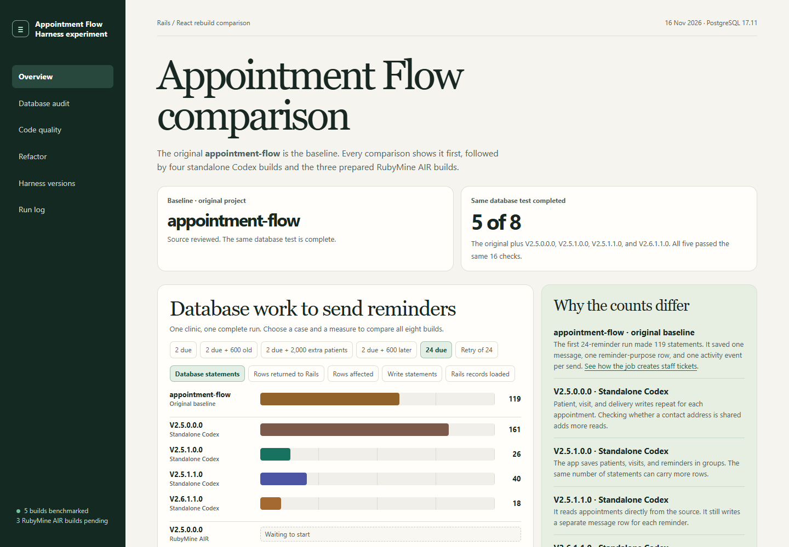

# Appointment Flow harness experiment

I iterated on a coding harness by giving AI agents the same Rails and React assignment and comparing what they built. I cared most about code a person could read and change, correct behavior under failure, and database work as data grows. Appointment Flow gave me real questions to test around reminders, replies, and staff follow-up.

[Harness versions and downloads](VERSIONS.md) · [Experiment dashboard](dashboard/index.html) · [AI usage](AI_USAGE.md) · [Regression log](reports/Appointment_Flow_Harness_Regression_Log.md)

## What improved

### The reminder benchmark

Each measured version sent the same 24 synthetic reminders. The original app is the historical control. All five completed the same 16-check workload.

| Version | Execution environment | Database statements for 24 reminders |
|---|---|---:|
| Original appointment-flow | Historical app | 119 |
| V2.5.0.0.0 | Standalone Codex | 161 |
| V2.5.1.0.0 | Standalone Codex | 26 |
| V2.5.1.1.0 | Standalone Codex | 40 |
| V2.6.1.1.0 | Standalone Codex | 18 |
| V2.5.0.0.0 | RubyMine AIR | No completed measurement |
| V2.5.1.0.0 | RubyMine AIR | No completed measurement |
| V2.5.1.1.0 | RubyMine AIR | No completed measurement |

V2.6.1.1.0 used about 85% fewer statements than the historical control on this operation. The counter alone can hide work. With 600 later appointments added, V2.5.1.0.0 still sent the same two reminders in 26 statements while rows returned to Rails rose from 13 to 1,213. [Run report](reports/V2.6_Run_Report.md) · [Matched workload](benchmarks/V2.6_Compared_Workload.csv)

### The working baseline and the query rule

V2.7.3.1.0 remains the working full-rebuild baseline. In a later 44-check workload, it passed 40 cases. V2.7.4.1.0 passed all 44 and reduced the two-send run with 600 later appointments from 1,228 statements to 16. Its application query rules lived in handwritten SQL views and functions, so it failed the plain Active Record standard. The historical app has no complete run on this exact workload. [Matched comparison and decision](reports/V2.7.4_Candidate.md)

V2.7.5.1.0 makes that source rule a separate gate. Running the harness against the original app replaced authored SQL in one patient appointment query. A follow-up added two indexes in the app database. Across 330 measured requests, the tested bodies and cursors matched. On the grown fixture, loading two visit records went from 176 shared buffer hits to three. The external PMS schema stayed fixed. Full-request growth still earns REVISE because the patient-access check and one upcoming-history join scan unrelated rows. [Refactor report](reports/PATIENT_APPOINTMENTS_REFACTOR.md) · [Index follow-up](reports/PATIENT_APPOINTMENTS_MIRROR_INDEX.md) · [Request metrics](benchmarks/V2.7.5_Patient_Appointment_Index_Workload.csv)

## How I decided which version was better

1. Compare the same caller, input, response, and persisted effects on frozen revisions. Use controlled rebuilds and scoped refactors to answer different questions.
2. Measure statements, rows returned, records loaded, writes, and elapsed time separately. Add unrelated history, grow eligible work, and replay the same request where appropriate.
3. Trace the entry point to the business rule and failure boundary. Test a small rule change in a disposable copy to see where a developer would make it.
4. Verify standard Active Record at the application query source. Rails-generated SQL is expected. Trace through schema objects so a model mapped to a handwritten query view cannot pass by appearance.
5. Record what the AI review fixed, where it missed a regression, and what the independent checks established. A scoped pass only establishes the behavior exercised in that scope.

One build per variant gives evidence about those builds. Host settings and the builder’s design choices also affect the result. The [version history](VERSIONS.md) marks historical observations, measured runs, prepared runs, and packaged proposals.

## Explore and reproduce

- Open `dashboard/index.html` in a browser from a local clone. Its earlier comparison retains the original baseline and all three prepared RubyMine AIR runs.
- Use the [version catalog](VERSIONS.md) for harness archives and [frozen application builds](snapshots/FROZEN_BUILDS.md) for the recorded revisions. Compare public archives against [SHA-256 checksums](SHA256SUMS.txt).
- Use the [launch prompt](reports/V2.5_Launch_Prompt.md), [benchmark CSVs](benchmarks/), and linked run reports to identify the workload and frozen checkpoints.
- The company-supplied take-home PDF is omitted from public files and nested archives. The public exports include the author’s code and screenshots. Original preflight expects the original reference inputs. The archive manifest records separate digests for source inputs and published exports.
