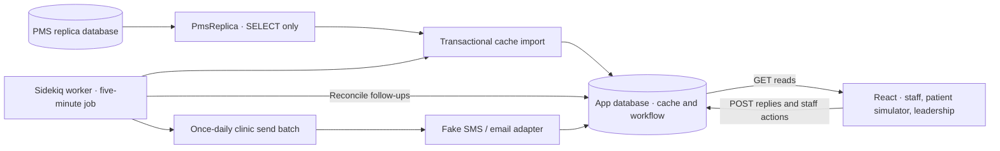
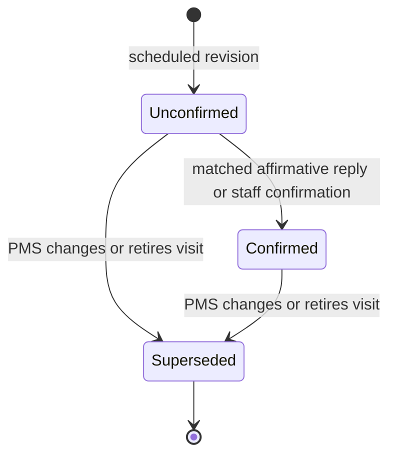
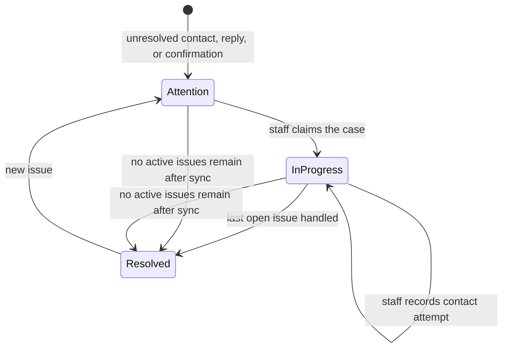

# Appointment Flow architecture

Rails serves React, and a separate Sidekiq process runs the reminder worker through a Redis queue. It reads a separate PostgreSQL replica through one SELECT-only gateway. Its own database holds a source cache and the reminder workflow. There is no source HTTP service or write API.

| Owner | Records |
| --- | --- |
| PMS replica | Clinics, patients, and appointments with clinic wall-clock times. Appointment status is read as supplied; no outcome overlay or arrival-time table is required. |
| Appointment Flow | Cached source records, visit revisions, confirmations, contact permissions, opt-outs, send receipts, follow-up cases, and history. Clinic ownership comes from the source appointment. |

The demo assumes messaging permission is granted until revoked. Import creates SMS/email grants for new patient/clinic pairs at messaging-enabled clinics and preserves existing grants and opt-outs. This is an app-owned policy, not consent supplied by the PMS. Guardian authorization remains separate and defaults to absent for new pairs. Production permission provenance is not implemented.

`PmsReplica` reads the complete source in a repeatable-read, read-only transaction with a SELECT-only role and connection/statement timeouts. `PmsSnapshot#refresh` owns the app transaction covering its snapshot lock, cached rows, and freshness timestamp. Errors roll them back together. Missing scheduled appointments are marked `missing` in the app cache only after a successful complete read; they retire from outreach without becoming rescheduled outcomes. Complete reads retain guarantors without appointments.

Sidekiq runs ReminderJob at startup and sidekiq-cron enqueues it every five minutes. Failed clinic work is logged and other clinics still run, then the tick raises for retry. Source-read failures preserve cached maintenance and skip sends before raising. The job exposes sanitized failures to Sidekiq, with five retries. Existing database locks and daily markers protect repeated jobs. GET screens do not import, confirm, create cases, or close follow-ups. A failed read leaves the cache and last-success timestamp intact; once five minutes old, it is flagged stale. The replica has its own upstream lag.

The runner maintains follow-ups every five minutes. When a send batch is due, it forces a source read before sending. A clinic runs once per local date, starting at 10 AM, with catch-up before 6 PM. It refreshes the source before evaluating the upcoming reminder window. A clinic lock protects the date recorded with the batch, and a unique visit-and-purpose key prevents duplicate simulated deliveries. If the source is unavailable or stale, the batch remains due. The transport interface separates send policy from the fake adapter.

## Confirmation and follow-up

A change to the patient, clinic, time, or scheduling status retires the old revision. A routine provider or duration edit leaves it intact. A replacement on a different row starts with a new confirmation. A staff-recorded cancellation or reschedule holds the old revision while the source catches up. That action writes only to Appointment Flow.

Delivery, confirmation, follow-up, and attendance are separate facts. A clear affirmative reply can confirm a single matching current visit when the local source snapshot is fresh. Email has receipt context. SMS matching checks the clinic sender and destination across relevant past and future sent visits. Shared contacts and competing matches can require staff review. An old reply cannot confirm a new revision. Historical events remain visible. A staff case can cover several visits and resolving one issue leaves unrelated issues open.

Each closed issue links to its resolution event. The board reads the recorded actor, outcome, and timestamp from that event. Contact decisions use stable reason codes; their displayed sentences do not control queue eligibility. The worker reconciles revisions and follow-ups independently of the send batch. Claims and contact notes may use cached records during an outage. Confirmations and final scheduling outcomes require a successful source read. That cannot eliminate upstream replica lag.

## Access and limits

The local sign-in stub scopes staff by clinic on the server. Leadership receives aggregate data. The patient simulator loads the chosen clinic and patient's conversation. Setup generates relative dates once; runtime uses real time. Tests freeze time with separate source and app databases.

For production, staff would sign in through Apex's identity provider. The server would use role-based access control to enforce least privilege. Front-desk staff could view patient and appointment details and record follow-up only for clinics they are assigned to. Leadership could see aggregate reports for clinics they are authorized to oversee. The leadership role alone would grant no access to patient conversations or staff actions.

The server would check the role and clinic assignment on every request, including requests made directly to an API endpoint. Staff without the required access would be denied by default. The patient simulator would be removed before production.

The granted-until-revoked policy is an assessment assumption; production needs a verified source of permission evidence. Real-provider secrets, inbound request authentication, and durable delivery reconciliation are not implemented. [DECISIONS.md](DECISIONS.md) records choices and open questions.

## Local packaging

Docker Compose runs PostgreSQL, Rails, Redis with append-only persistence, and a Sidekiq worker with concurrency one. A one-time setup container provisions both databases and roles, then exits. The app does not receive provisioner credentials. Tests use disposable databases. This is local packaging, not production deployment or infrastructure provisioning.

Reminder policy uses fixed English/Spanish templates. Day 7 requests confirmation by SMS; unanswered SMS gets permitted email on day 6. Day 3 repeats SMS only with no reply. Day 1 is an informational reminder for confirmed visits and a YES/NO request for unconfirmed visits. The optional scale profile runs the same importer and batch against disposable databases; it does not expand the interactive seed.

Reporting maps `complete` to completed, `broken` to rescheduled, and `unscheduled` to canceled under the demo assumptions. The brief says staff sometimes break the old appointment when rescheduling. The supplied fields cannot distinguish all reschedules, late cancellations, and no-shows. Past scheduled visits remain unknown. The calendar and follow-up details display the source provider name. The replica reader needs only the three supplied tables.

To measure no-show reduction, first agree with clinic staff on a reliable attendance outcome and validate it against PMS records. Then compare a reminder pilot with clinics or appointment groups that keep their usual process during the same period. Track no-shows per eligible appointment and separately track cancellations, delivery failures, and staff follow-up workload. The synthetic history demonstrates the reporting workflow.

## Reading the Rails code

| Responsibility | Start here |
| --- | --- |
| CSRF protection and conflict handling | `app/controllers/application_controller.rb` |
| Source records, relationships, and reconciliation selection | `app/models/appointment.rb`, `visit.rb`, `patient.rb` |
| Screen data | `app/queries/appointments_query.rb`, `board_query.rb`, `case_detail_query.rb` |
| JSON fields exposed to React | `app/serializers/` |
| Staff claim, contact attempt, and final outcome | `app/services/record_follow_up.rb` |
| Phone/email validation and adult recipient selection | `app/services/contact_policy.rb` |
| Visit reconciliation | `app/services/reconcile_appointments.rb` |
| Daily batch transaction | `app/services/reminder_flow.rb` |
| Applying contact/schedule decisions and recording deliveries | `app/services/reminder_sender.rb` |
| Day 7/6/3/1 timing decisions | `app/services/reminder_schedule.rb` |
| English and Spanish message text | `app/services/message_templates.rb` |
| Reply matching, opt-outs, and reply classification | `app/services/receive_reply.rb` |
| Issue creation and automatic closure | `app/services/follow_up_workflow.rb` |
| Clinic patient roster | `app/queries/contact_profiles_query.rb` |
| Current-revision confirmation and clinic wall-clock conversion | `app/models/visit.rb` |
| Leadership counts and retained message history | `app/queries/operations_query.rb` |
| PostgreSQL locks and setup/diagnostics | `infrastructure/database.rb` |
| Case/calendar reply presentation | `Visit#latest_patient_reply` → `AppointmentSerializer` → `frontend/src/shared/format.js` |
| Bounded reply examples | `test/reply_test.rb` |

For an appointment page, trace controller access checks → `AppointmentsQuery` → appointment/visit models → `AppointmentSerializer` → React. For reconciliation, start at `ReconcileAppointments#for_clinic`. It selects changed and upcoming appointments through `Appointment.needing_reconciliation`, takes the appointment locks together, and reloads the current visits under those locks. It retires obsolete revisions and validates replacements before inserting them together. Patient, clinic, and time changes require a new confirmation; provider and duration edits do not.

Application models connect to the application database. `PmsRecord` marks source-cache models read-only for ordinary model writes. The transactional importer compares typed source rows and uses Active Record bulk writes for changes. `PmsReplica::Record` has a separate SELECT-only connection; its models read only the supplied source fields. The database session shares one connection between diagnostic SQL and Active Record; provisioning uses a separate admin connection.

The visit loader returns `Visit` models with related records preloaded. `ContactPolicy` owns adult/guarantor checks and returns a named `Recipient` value. Serializers format screen responses. Case and calendar queries use `Visit#latest_patient_reply` and `AppointmentSerializer` for shared reply fields, including `declined_reply`. Both screens use `confirmationLabel` from `frontend/src/shared/format.js`. An open review takes display precedence over a recorded confirmation without deleting that confirmation.

Read actions call their queries directly. Staff requests check the scoped case before refreshing the source for final outcomes. The refresh commits independently. RecordFollowUp acquires the clinic lock and rechecks the case, staff assignment and clinic access. It reconciles visits associated with the case, then locks and reloads the case before applying the requested outcome.

ReconcileAppointments owns visit revision changes and calls FollowUpWorkflow to close obsolete issues. FollowUpCase owns its version, owner and progress transition. A returned stale-case conflict commits reconciliation. A raised rejection rolls back reconciliation and any action writes. Both paths preserve the earlier successful source refresh.

ReceiveReply owns the reply transaction. It reloads the sent receipt and selects its visit under the clinic lock, then takes the request-key lock before checking for duplicates and recording a decision. ReminderFlow#run_daily_batch owns the daily marker and fake deliveries in one transaction. Database.open borrows the app connection for raw SQL fixtures and the scale command. Database.provision opens the setup connection. Unexpected runner failures log exception classes and locations so patient text in exception messages stays out of logs.

These transaction guarantees apply to the fake adapter. A real provider cannot undo a delivered message when our database rolls back; a production adapter needs a durable delivery/reconciliation design.

The report groups appointment status counts in PostgreSQL through Active Record and combines them with outreach and follow-up totals. Sent-message history is keyed by appointment, patient, clinic, and original time, so moving an appointment does not move its historical replies. The scale command measures this read too; retained history increases its cost.

Rails migrations own table definitions and version history. Ruby seeds build the synthetic records and walkthrough history. PostgreSQL-specific infrastructure covers account permissions, concurrency locks, and diagnostic/scale fixtures. Source reads and application queries use standard Active Record. Cache age uses the application's real system clock, independently of simulated workflow dates in tests.

The app mirror keeps raw source values and indexed contact comparisons together. The importer maintains the comparisons, and local detail verification maintains its comparison value. `ContactPolicy` remains responsible for selecting an authorized adult. The read first finds matching raw or locally verified contacts and their authorized dependents, then applies that policy. A permission change affects the next read without rebuilding a clinic roster.

`AppointmentHistory` stores the latest recorded time for each appointment/patient/clinic identity. Single visit creation and bulk reconciliation update it within the owning transaction. Source appointments take precedence over it in history reads. Paging reads at most 26 source identities and 26 tracked identities before loading their context. Each displayed appointment retains its revision history. `IssueCandidate` maintains indexed relationships for each issue's owning visit and the candidate IDs recorded on reply reviews. `FollowUpIssue` saves those relationships with the issue; its JSON values remain inspectable and keep their API meaning. Stored month, missing-birthdate, and resolution buckets update automatically in PostgreSQL, including bulk writes. The app migration backfills these values and relationships. There is no report cache or additional worker.

Controller responsibilities: `ApplicationController` shares CSRF protection and conflict handling; `DeskController` handles front-desk work; `PatientsController` handles inboxes and replies; `OperationsController` handles leadership reports; `WorkspacesController` serves the React shell and workspace selection.

Database setup: `bin/setup.rb` provisions accounts, calls `bin/setup_replica.rb` for the separate source migrations and `db/replica/seeds.rb`, runs `db/migrate/`, and loads `db/seeds.rb`. App setup imports the PMS snapshot and provisions clinic settings and staff from configuration. The workflow creates its own history. Tests load their own fixtures.

## Reading the React code

`requests.js` owns fetch, HTTP status interpretation, and response decoding. Only the API's explicit 409/422 error responses establish rejection; transport failures or malformed write results leave the outcome uncertain. `usePage` tracks reads separately from submissions, aborts obsolete reads, and does not repeat POSTs during recovery. A successful POST and its following GET have separate outcomes.

Both staff URLs open the same patient workspace. `CaseDetailQuery` supplies the summary and verification fields, while `PatientWorkspaceHistory` pages clinic-scoped appointments, follow-up records, and activity. The appointment view combines source rows with tracked visit revisions and links history through recorded IDs. Message destinations come from the receipt. An issue reopen retains the previous resolution reference, and Operations counts the issue once in its current state.

`FollowUpForm` owns its selected issue, outcome, and note. Refresh cannot silently replace the selected issue with another appointment. `ReplyForm` is keyed by receipt and owns its text. Patient/clinic/channel controls cannot switch the request target while a reply is pending. Server records remain authoritative; forms retain local text on rejection or uncertainty.
